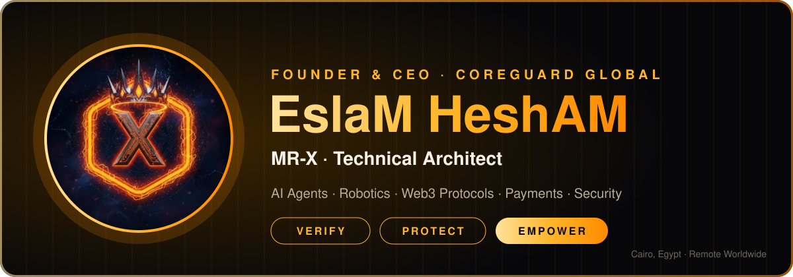

# Invest in CoreGuard Global

**Trust before execution — for AI agents, wallets, payments and dApps.**

**VERIFY · PROTECT · EMPOWER** · *Evidence over claims.*

---

## 1 · The opportunity

Autonomous AI agents are starting to move money and sign transactions. Nobody independently checks that **what executes is exactly what the user approved**. CoreGuard is that independent check: an **Authorization Firewall**, **Execution Verification** and **Verifiable Consent Receipts**, built on the open **CGEP/1** protocol.

## 2 · What already exists — verifiable today

| Evidence | Status | Proof |
| --- | --- | --- |
| Test suite | **<!--cg:tests-->2,103<!--/cg--> / <!--cg:tests-->2,103<!--/cg--> passing** | [state-snapshot.json](https://github.com/coreguard-global/CoreGuard/blob/main/docs/state-snapshot.json) |
| Boundary audit | **<!--cg:files-->1,595<!--/cg--> files · 0 violations** | [state-snapshot.json](https://github.com/coreguard-global/CoreGuard/blob/main/docs/state-snapshot.json) |
| Core DAO Mainnet | **Commitment anchor LIVE** · chainId 1116 | [EVIDENCE.md](https://github.com/coreguard-global/CoreGuard/blob/main/docs/EVIDENCE.md) |
| Stellar · Pi Network | Dry-run / plan-only | [STATUS.md](https://github.com/coreguard-global/CoreGuard/blob/main/docs/STATUS.md) |
| Agent Commerce MCP | Listed on MCPRush | [Listing](https://mcprush.com/eslam-x/coreguard-agent-commerce-mcp) |
| Execution proof stack | ProofX v0.4.0 · PiProof v1.0.0 | [ProofX](https://github.com/EslaM-X/proofx) · [PiProof](https://github.com/EslaM-X/piproof) |

> **Truth boundary:** zero external customers, zero signed pilots, zero production integrations recorded. We show it because serious investors check.

## 3 · Investment table — current funding ask

**$150,000 requested — not awarded.** Milestone-gated, four months (SCF #46 Build Award, under review). This is a development grant ask, **not an equity round and not a valuation**.

| Tranche | Amount | Released when |
| --- | ---: | --- |
| **T1** | $40,000 | M1 accepted |
| **T2** | $55,000 | M2 accepted |
| **T3** | $55,000 | M3 and M4 accepted |
| **Total** | **$150,000** | |

| Use of funds | Amount |
| --- | ---: |
| Engineering — 2 contractors (Soroban + SDK/DX) | $84,000 |
| Independent security review | $18,000 |
| Contract audit retainer (Soroban + EVM) | $12,000 |
| Pilot integration support | $12,000 |
| Infrastructure (RPC, CI, hosting) | $6,000 |
| Legal, licensing, data-handling terms | $6,000 |
| Documentation & developer experience | $6,000 |
| Contingency (≤ 5%) | $6,000 |

Equity, strategic or angel conversations are open — terms are discussed directly with the founder.

## 4 · Goals of the organisation

| Milestone | Goal | Proof of done |
| --- | --- | --- |
| **M1 · SDK v1** | Install → PASS/BLOCK verdict in ≤ 15 minutes | Committed quickstart transcript |
| **M2 · Authorized lane** | Soroban `commit_authorized` on testnet from CI-built wasm | Deploy tx + read-back in `docs/evidence/` |
| **M3 · Two pilots** | One DEX/wallet + one AI-agent payments partner | Two published pilot reports, ≥ 1 paid engagement or signed LOI |
| **M4 · Institutional readiness** | Independent security review + enterprise pack | Review report and remediation committed |

**Long-term vision:** become the neutral trust layer every AI agent, wallet and payment rail checks before it executes.

## 5 · Founder

**EslaM HeshAM (MR-X)** — Technical Architect, Founder & CEO of CoreGuard Global. Cairo, Egypt · remote worldwide. Open-source contributions to [Pi Network](https://github.com/PiNetwork/PiRC/pull/2), [Stellar](https://github.com/stellar/stellar-core/pull/5409), [CNCF Buildpacks](https://github.com/buildpacks/pack/pull/2681), [Fabric RoboPay](https://github.com/fabricfoundation/RoboPay/pull/120) and [actionlint](https://github.com/rhysd/actionlint/pull/729). [CV](https://github.com/EslaM-X/portfolio/blob/main/CV.md) · [All projects](https://github.com/EslaM-X/EslaM-X/blob/main/PROJECTS.md)

## 6 · Contact

| Channel | Link |
| --- | --- |
| ✉️ Email | [eslam.kora60@gmail.com](mailto:eslam.kora60@gmail.com?subject=CoreGuard%20investment) |
| 💼 LinkedIn | [EslaM HeshAM](https://www.linkedin.com/in/eslam-hesham-359964192) · [CoreGuard Global](https://www.linkedin.com/company/coreguard-global) |
| 𝕏 X | [@EslaM_HeshAM_X](https://x.com/EslaM_HeshAM_X) |
| 🌐 Website | [coreguard-trust-and-defense.lovable.app](https://coreguard-trust-and-defense.lovable.app) |
| 📚 Deep diligence pack | [COREGUARD-INVESTMENT-READINESS.md](https://github.com/coreguard-global/CoreGuard/blob/main/COREGUARD-INVESTMENT-READINESS.md) |

---

Not an offer to sell securities. Figures come from public CoreGuard documents and may change. Read the <a href="LEGAL.md#investor-notice">investor notice and disclaimers</a> before acting.

<a href="https://github.com/EslaM-X">← Back to EslaM-X</a>

