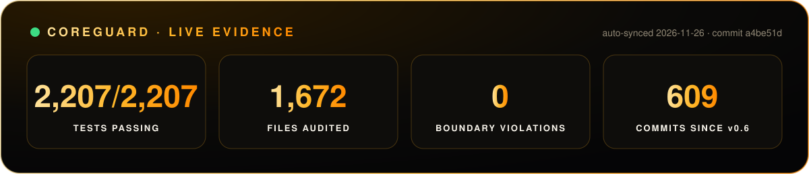

# Invest in CoreGuard Global

The official, always-current investment document lives in the CoreGuard organisation:

### [📚 Official Investment Readiness Pack →](https://github.com/coreguard-global/CoreGuard/blob/main/COREGUARD-INVESTMENT-READINESS.md)

**$150,000 requested — not awarded** · milestone-gated over four months · SCF #46 Build Award under review · not an equity round, not a valuation.

[**Investor page (English)**](https://eslamx-coreguard-showcase.lovable.app/en/invest) · [**صفحة المستثمرين (عربي)**](https://eslamx-coreguard-showcase.lovable.app/invest) · [**Team & partners**](https://github.com/EslaM-X/EslaM-X/blob/main/TEAM.md) · [**Professional site**](https://eslamx-coreguard-showcase.lovable.app/pro)

✉️ [eslam.kora60@gmail.com](mailto:eslam.kora60@gmail.com?subject=CoreGuard%20investment)

Not an offer to sell securities. Read the <a href="LEGAL.md#investor-notice">investor notice</a>.

