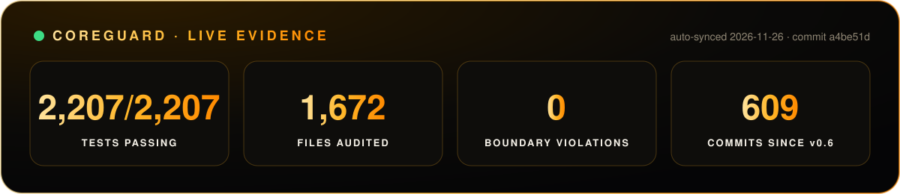
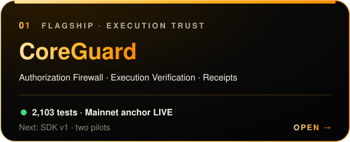
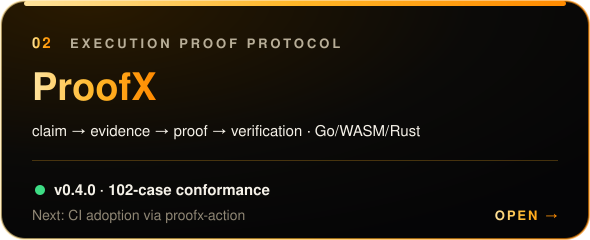
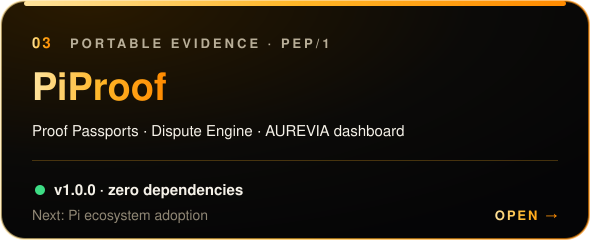
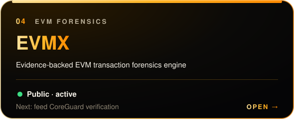
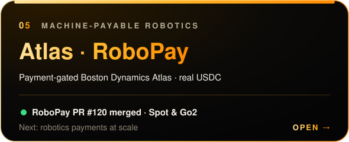
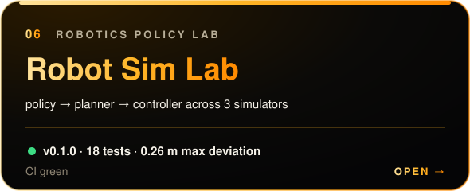
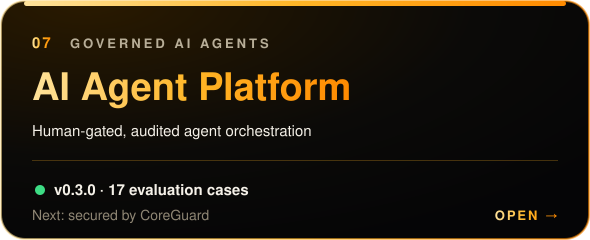
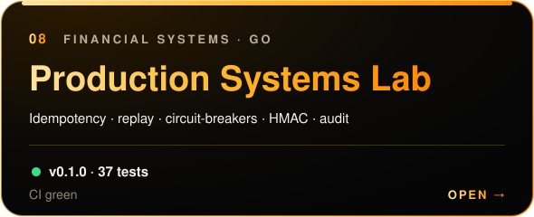
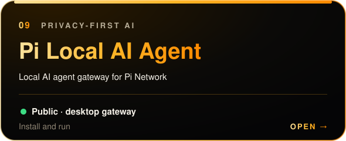

# EslaM-X Projects — Evidence Over Claims

**VERIFY · PROTECT · EMPOWER.** Execution trust, verifiable protocols, governed agents, and machine-payable robotics—built for investors, partners, and developers who demand evidence.

**EslaM HeshAM (MR-X)** · Technical Architect · Founder & CEO, CoreGuard Global  
Cairo, Egypt · Remote worldwide

## The Portfolio

---

## Contents

- [CoreGuard](#coreguard)
- [proofx](#proofx)
- [piproof](#piproof)
- [evmx](#evmx)
- [atlas-shelf-inspection](#atlas-shelf-inspection)
- [robopay-spot-tier1](#robopay-spot-tier1)
- [robopay-go2-tier1](#robopay-go2-tier1)
- [robot-sim-policy-lab](#robot-sim-policy-lab)
- [ai-agent-automation-platform](#ai-agent-automation-platform)
- [production-systems-lab](#production-systems-lab)
- [pi-local-ai-agent](#pi-local-ai-agent)
- [More repositories](#more-repositories)

## CoreGuard

**Independent Execution Trust Infrastructure for AI agents, wallets, payments, and dApps.** CoreGuard brings authorization, execution verification, and verifiable consent into a dedicated trust infrastructure.

**How it works**
- Uses an Authorization Firewall and Execution Verification.
- Produces Verifiable Consent Receipts through the CGEP/1 protocol.
- Anchors commitments on Core DAO Mainnet, chain ID `1116`.
- Includes Stellar and Pi Network integrations in **dry-run/plan-only** mode.

**Current stage:** Commitment anchor live on Core DAO Mainnet; listed on MCPRush. The documented state snapshot records **<!--cg:tests-->2,103<!--/cg-->/<!--cg:tests-->2,103<!--/cg--> tests passing** and **<!--cg:files-->1,595<!--/cg--> files scanned with 0 boundary violations**.

**Commercial truth boundary:** Zero external customers. Zero signed pilots. Funding requested—not awarded. Mainnet evidence and measured engineering state are not claims of commercial traction.

**Next goal:** SDK v1, a Soroban authorized lane on testnet, two external pilots, and an independent security review, as outlined in the investment readiness milestone plan.

**Links:** [Repository](https://github.com/coreguard-global/CoreGuard) · [State snapshot](https://github.com/coreguard-global/CoreGuard/blob/main/docs/state-snapshot.json) · [Status](https://github.com/coreguard-global/CoreGuard/blob/main/docs/STATUS.md) · [Mainnet evidence](https://github.com/coreguard-global/CoreGuard/blob/main/docs/EVIDENCE.md) · [Investment readiness pack](https://github.com/coreguard-global/CoreGuard/blob/main/COREGUARD-INVESTMENT-READINESS.md) · [MCPRush listing](https://mcprush.com/eslam-x/coreguard-agent-commerce-mcp) · [Website](https://coreguard-trust-and-defense.lovable.app)

## proofx

**An execution proof protocol that moves from claim to verification.**

**How it works**
- Structures execution proof as **claim → evidence → proof → verification**.
- Provides Go/WASM/Rust CLI tooling and a GitHub Action.
- Includes a 102-case conformance suite.

**Current stage:** **v0.4.0 stable**; protocol frozen.

**Next goal:** Adoption in CI pipelines via proofx-action and Homebrew.

**Links:** [Repository](https://github.com/EslaM-X/proofx)

## piproof

**Portable, verifiable evidence built on PEP/1.**

**How it works**
- Packages evidence through Proof Passports.
- Includes a Dispute Engine.
- Provides the AUREVIA dashboard.

**Current stage:** **v1.0.0**, with zero dependencies.

**Next goal:** Pi ecosystem adoption alongside PiRC standards.

**Links:** [Repository](https://github.com/EslaM-X/piproof)

## evmx

**An evidence-backed EVM transaction forensics engine.**

**Current stage:** Public and active.

**Next goal:** Feed forensics evidence into CoreGuard verification.

**Links:** [Repository](https://github.com/EslaM-X/evmx)

## atlas-shelf-inspection

**Payment-gated Boston Dynamics Atlas shelf inspection.**

**How it works**
- Gates Atlas shelf inspection through payment.
- Uses MuJoCo, PyBullet, and Webots.
- Uses real USDC on **Base Sepolia**.

**Current stage:** RoboPay **PR #120 merged**. Related robotics repositories include Spot and Go2 Tier-1 profiles.

**Next goal:** Machine-payable robotics at scale.

**Links:** [Repository](https://github.com/EslaM-X/atlas-shelf-inspection) · [Merged RoboPay PR #120](https://github.com/fabricfoundation/RoboPay/pull/120) · [Spot Tier-1](https://github.com/EslaM-X/robopay-spot-tier1) · [Go2 Tier-1](https://github.com/EslaM-X/robopay-go2-tier1)

## robopay-spot-tier1

**A Spot Tier-1 profile repository in the RoboPay robotics work.**

**Links:** [Repository](https://github.com/EslaM-X/robopay-spot-tier1)

## robopay-go2-tier1

**A Go2 Tier-1 profile repository in the RoboPay robotics work.**

**Links:** [Repository](https://github.com/EslaM-X/robopay-go2-tier1)

## robot-sim-policy-lab

**A robotics policy lab spanning three simulators.**

**How it works**
- Connects **policy → planner → controller → three simulators**.
- Includes 18 tests.
- Measures sim-to-sim deviation, with a recorded maximum of **0.26 m**.

**Current stage:** **v0.1.0**, CI green.

**Links:** [Repository](https://github.com/EslaM-X/robot-sim-policy-lab)

## ai-agent-automation-platform

**Human-gated, audited, governed AI agent orchestration.**

**How it works**
- Organizes orchestration around planning, policy, and execution.
- Applies human gates and auditing.
- Uses 17 evaluation cases across 6 dimensions, with a regression gate.

**Current stage:** **v0.3.0**, CI green.

**Next goal:** Governed agents secured by CoreGuard.

**Links:** [Repository](https://github.com/EslaM-X/ai-agent-automation-platform)

## production-systems-lab

**Go building blocks for financial systems.**

**How it works**
- Provides idempotency and replay building blocks.
- Includes circuit-breakers and HMAC authentication.
- Implements hash-chained auditing.
- Includes 37 tests.

**Current stage:** **v0.1.0**, CI green.

**Links:** [Repository](https://github.com/EslaM-X/production-systems-lab)

## pi-local-ai-agent

**A privacy-first local AI agent for Pi Network.**

**How it works**
- Runs locally.
- Provides an install-and-run desktop gateway.

**Current stage:** Public.

**Links:** [Repository](https://github.com/EslaM-X/pi-local-ai-agent)

## More repositories

- **AlJefra-OS** — Public repository. [Repository](https://github.com/EslaM-X/AlJefra-OS)
- **MapCap IPO** — Public frontend and backend repositories. [Frontend](https://github.com/EslaM-X/mapcap-ipo-frontend) · [Backend](https://github.com/EslaM-X/mapcap-ipo-backendX)

---

**Invest. Partner. Build. Verify first.**

For investment, partnership, or developer conversations: [eslam.kora60@gmail.com](mailto:eslam.kora60@gmail.com) · [LinkedIn](https://linkedin.com/in/eslam-hesham-359964192) · [X](https://x.com/EslaM_HeshAM_X)

[Back to EslaM-X](https://github.com/EslaM-X) · [Investor page](https://github.com/EslaM-X/EslaM-X/blob/main/INVEST.md)
