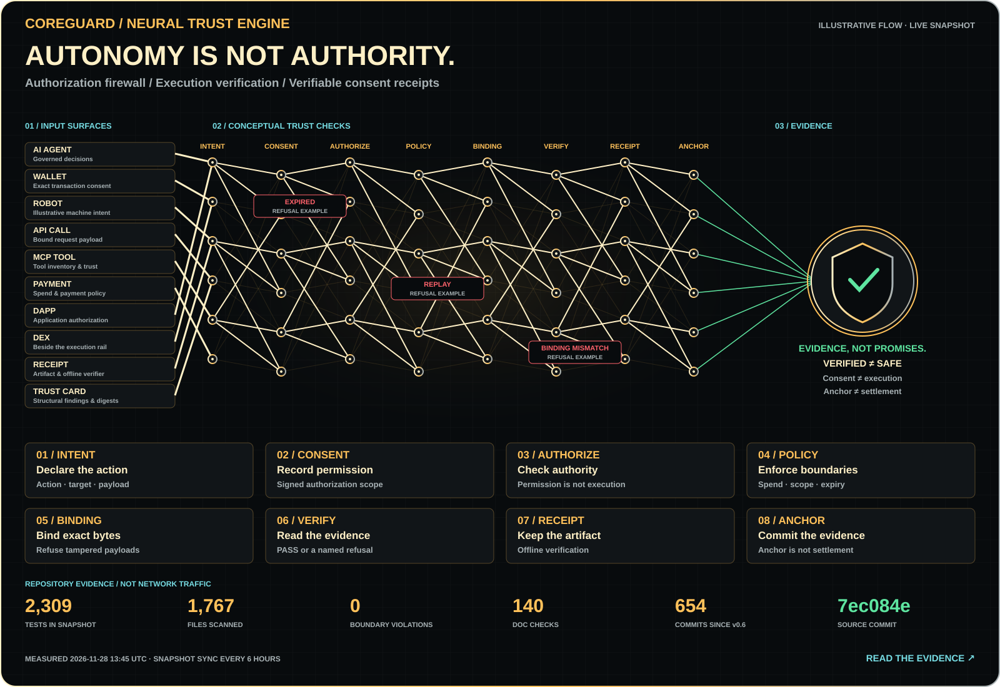

# The CoreGuard Team

**VERIFY · PROTECT · EMPOWER** — the independent trust layer for AI execution.

### EslaM HeshAM · MR-X
**Technical Architect · Founder & CEO, CoreGuard Global** · Cairo → remote worldwide

Builds [CoreGuard](https://github.com/coreguard-global/CoreGuard) · [ProofX](https://github.com/EslaM-X/proofx) · [PiProof](https://github.com/EslaM-X/piproof) · [all projects](https://github.com/EslaM-X/EslaM-X/blob/main/PROJECTS.md)

Open source: [Pi Network PiRC #2](https://github.com/PiNetwork/PiRC/pull/2) · [stellar-core #5409](https://github.com/stellar/stellar-core/pull/5409) · [CNCF pack #2681](https://github.com/buildpacks/pack/pull/2681) · [Fabric RoboPay #120](https://github.com/fabricfoundation/RoboPay/pull/120) · [actionlint #729](https://github.com/rhysd/actionlint/pull/729)

[GitHub](https://github.com/EslaM-X) · [LinkedIn](https://www.linkedin.com/in/eslam-hesham-359964192) · [X](https://x.com/EslaM_HeshAM_X) · [CV](https://github.com/EslaM-X/portfolio/blob/main/CV.md)

<table><tr><td width="150" align="center"></td><td>

### Wissal Yahia · SEVEN JUNE
**AI &amp; Decision-Intelligence Engineer** 
Machine learning for AI-agent risk scoring, execution insights and evidence dashboards.

[GitHub](https://github.com/sevenjunebaby) · [LinkedIn](https://www.linkedin.com/in/wissalyahia) · [Portfolio](https://wissalyahia.vercel.app/)

</td></tr></table>

<table><tr><td width="150" align="center"></td><td>

### Yiğit Efe Kaya
**Developer Tooling &amp; Quality Engineer** 
Rust/TypeScript tooling, automated quality and bug scanning, network hardening for the SDK and CI.

[GitHub](https://github.com/YigitEfe-DEV) · [LinkedIn](https://www.linkedin.com/in/efe-yigit-kaya-250392271) · [Website](https://efeyigit.me)

</td></tr></table>

**Soroban engineer** — authorized lane on Stellar (M2)
**SDK / DX engineer** — SDK v1, quickstart, docs (M1)
**Independent security reviewer** — signed envelope + contracts review (M4)

Funded by the milestone plan in the <a href="https://github.com/coreguard-global/CoreGuard/blob/main/COREGUARD-INVESTMENT-READINESS.md">official pack</a>.

<table><tr>
<td width="180" align="center"></td>
<td>

### CoreGuard — the firewall in front of every wallet
Before any AI agent, bot or app can move funds, CoreGuard checks **who** is asking, **what** they are allowed to do and **whether** the action matches the user's consent. Unauthorized, replayed or forged requests are refused *before* they reach the wallet, and every allowed action leaves a verifiable receipt.

Authorization Firewall · Execution Verification · Verifiable Consent Receipts

</td></tr></table>

🔗 <a href="https://github.com/coreguard-global/CoreGuard/blob/main/README.md"><b>Official docs</b></a> · <a href="https://github.com/coreguard-global/CoreGuard/blob/main/docs/ARCHITECTURE.md">Architecture</a> · <a href="https://github.com/coreguard-global/CoreGuard/blob/main/docs/EVIDENCE.md">Evidence</a> · <a href="https://github.com/coreguard-global/CoreGuard/tree/main/test">Test suite</a> · <a href="https://github.com/coreguard-global/CoreGuard/blob/main/docs/state-snapshot.json">Live snapshot</a> · <a href="https://github.com/coreguard-global/CoreGuard/tree/main/src">Source</a> · <a href="https://github.com/coreguard-global/CoreGuard/blob/main/docs/DEVELOPER-QUICKSTART.md">Quickstart</a> · <a href="https://github.com/coreguard-global/CoreGuard/blob/main/SECURITY.md">Security</a>

We look for **wallets, DEXs, AI-agent payment teams and robotics platforms** for the two external pilots (M3), and for **auditors, accelerators and investors**.

[**🤝 Start a partnership**](mailto:eslam.kora60@gmail.com?subject=CoreGuard%20partnership) · [**Investor page**](https://eslamx-coreguard-showcase.lovable.app/en/invest) · [**صفحة المستثمرين**](https://eslamx-coreguard-showcase.lovable.app/invest) · [**Professional site**](https://eslamx-coreguard-showcase.lovable.app/pro)

No external customers or signed pilots are recorded yet — see the truth boundary in the <a href="https://github.com/coreguard-global/CoreGuard/blob/main/COREGUARD-INVESTMENT-READINESS.md">official pack</a>.

